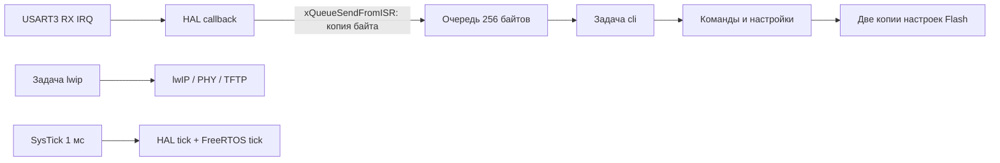

# STM32H755 CM7: FreeRTOS, Ethernet и UART CLI

Прошивка Cortex-M7 для STM32H755ZITx с HAL, lwIP (`NO_SYS=1`), PHY LAN8742
и двумя прикладными задачами FreeRTOS. Приложение линкуется с `0x08020000`;
отдельный экспериментальный загрузчик находится в `Core/startrc`.

## Выполнение



ISR передаёт байт, перезапускает приём и запрашивает переключение задачи.
Разбор и выполнение команд происходят в `cli`. Задача ожидает очередь до 100 мс;
таймаут нужен для восстановления приёма после ошибок. При потере входных данных
текущая команда отбрасывается до следующего Enter. Длинная строка также
отбрасывается; CR, LF и CRLF поддерживаются.

`lwip` единолично вызывает API lwIP и HAL Ethernet: при `NO_SYS=1` этот стек
нельзя одновременно вызывать из CLI. Сеть и CLI имеют приоритет 1 и стеки по
1024 слова (4096 байтов); сеть уступает процессор на 1 тик после обработки.
FreeRTOS дополнительно создаёт системные задачи Idle и timer service.
Инициализация сети происходит в её задаче, поэтому ожидание PHY не удерживает CLI.
Это независимость планирования, не изоляция отказов: общий `Error_Handler`
по-прежнему останавливает весь контроллер.

## CLI

USART3, **115200, 8N1**, без flow control. Пины задаёт
`Core/Src/stm32h7xx_hal_msp.c`. Начните с `help`.

| Команда | Действие |
|---|---|
| `help` | Список команд |
| `status` | Uptime, частота CPU, задачи, RTOS heap и минимальный остаток стеков, очередь и ошибки UART, активная конфигурация |
| `reboot` | Системный reset через CMSIS; несохранённые изменения теряются |
| `settings show` | Редактируемая конфигурация, признаки изменений и валидности |
| `settings set name relay-01` | Имя: 1–31 латинская буква/цифра/дефис, без дефиса на краях |
| `settings set ip 192.168.1.124` | Статический IPv4 |
| `settings set mask 255.255.255.0` | Непрерывная маска от /1 до /30 |
| `settings set gateway 192.168.1.1` | Шлюз в той же подсети; `0.0.0.0` отключает шлюз |
| `settings save` | Проверка всей конфигурации и сохранение во Flash |
| `settings defaults` | Заводские значения в RAM; для сохранения нужны `save` и `reboot` |

Пример перехода на другую подсеть:

```text
settings set name relay-01
settings set ip 192.168.10.50
settings set mask 255.255.255.0
settings set gateway 192.168.10.1
settings show
settings save
reboot
```

Изменения сначала накапливаются в RAM. Согласованность IP/маски/шлюза проверяется
на `save`, поэтому их можно последовательно менять. Сеть использует неизменяемую
копию, полученную при загрузке. Имя передаётся в hostname lwIP; DNS/mDNS-служба
этим не создаётся. Заводские значения: `cm7-device`, `192.168.1.123/24`, шлюз
`192.168.1.1`.

`status` показывает память FreeRTOS, а не всю занятую RAM и не загрузку CPU в процентах.
Состояния задач: 0 running, 1 ready, 2 blocked, 3 suspended, 4 deleted, 5 invalid.
Счётчики 32-битные; uptime в миллисекундах переполняется примерно через 49,7 суток.

## Энергонезависимые настройки

- `Core/Src/settings.c`: значения, валидация, формат записи, CRC32, выбор копии.
- `Core/Src/settings_flash.c`: стирание и программирование HAL.
- `Core/Src/flash_access.c`: общий mutex Flash для CLI и существующего TFTP writer.

Зарезервированы **Bank 2, сектор 6 (`0x081C0000`) и сектор 7 (`0x081E0000`),
по 128 KiB**. Это новый контракт размещения памяти: отдельная прошивка CM4,
загрузчик и программатор должны сохранять эти сектора. Проекта CM4 здесь нет,
поэтому его размещение не проверено. Mutex защищает только задачи CM7, не CM4.
Код отказывается сохранять при размере Flash не 2 MiB, включённом bank swap
или несоответствии адресов линкера. Используется напряжение программирования
2,7–3,6 В, соответствующее питанию 3,3 В платы.

Одна запись занимает 128 байтов: версия, номер поколения, параметры, CRC32
и отдельное последнее 32-байтное слово commit. При сохранении стирается другая
копия; предыдущая остаётся доступной. После записи выполняется проверка чтением.
Невалидные/отсутствующие записи дают заводские значения без автоматической записи.
Одинаковые значения повторно не стираются. Каждое сохранение изменённых значений
стирает сектор: механизм предназначен для редкой настройки, не для телеметрии.

Linker scripts не создают загружаемых секций в этих адресах. Прошивка ELF с
посекторным стиранием сохраняет настройки; mass erase их уничтожает.
Физические обрывы питания и ECC требуют отдельного испытания: тесты моделируют
повреждённые байты, но не аппаратные ECC/NMI STM32. Полная отказоустойчивость
при любом моменте потери питания не заявляется.

Дождитесь ответа `Saved` перед следующей командой: CLI занят во время стирания,
а RX-очередь конечна. IRQ и планировщик продолжают работать; приложение находится
в Bank 1, настройки — в Bank 2. Существующий TFTP writer пишет в Bank 1 и способен
задерживать исполнение кода из этого же банка; это отдельное ограничение updater.

## Сборка и проверки

Нужны GNU Make, Arm GNU Toolchain (GCC 11+ для используемого linker script)
и PowerShell на Windows. Для host-тестов нужны Python 3 и обычный `gcc`.

```powershell
make -j6
make BUILD=build/debug BUILD_TYPE=debug -j6
python tests/run_host_tests.py
```

Не смешивайте debug/release-объекты: используйте отдельный `BUILD`.
Основные артефакты: `stm32h755_cm7.elf`, `.hex`, `.bin`, `.map` внутри `BUILD`.
В Makefile перечислены включённые HAL-модули; при изменении
`stm32h7xx_hal_conf.h` обновите `ENABLED_MODULES`.

Host-тесты проверяют валидацию, сохранение/загрузку, неизменность активной
конфигурации, CRC fallback, 129 вариантов прерывания записи, команды CLI,
CRLF, переполнение строки и отбрасывание повреждённой команды. UART, Flash HAL,
NVIC reset и реальное планирование на MCU ими не эмулируются.

Проверка на плате:

1. Открыть UART, выполнить `help`, `status`, проверить рост uptime и network polls.
2. Во время ping многократно выполнять `status`; проверить минимальные остатки стеков.
3. Сохранить новое имя/IP, выполнить `reboot`, проверить имя, IP и ping.
4. Отключить питание, включить и проверить сохранённые настройки.
5. Проверить неверные IP/маски, несохранённые изменения и `settings defaults`.
6. Подать длинный поток UART и проверить счётчики потерь и восстановление через Enter.
7. Отдельно испытать отключение питания во время `save` и реакцию на ошибки Flash/ECC.

Разбор исходного состояния, Git и оставшихся рисков: [docs/REVIEW.md](docs/REVIEW.md).
