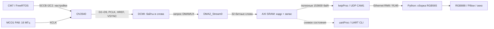
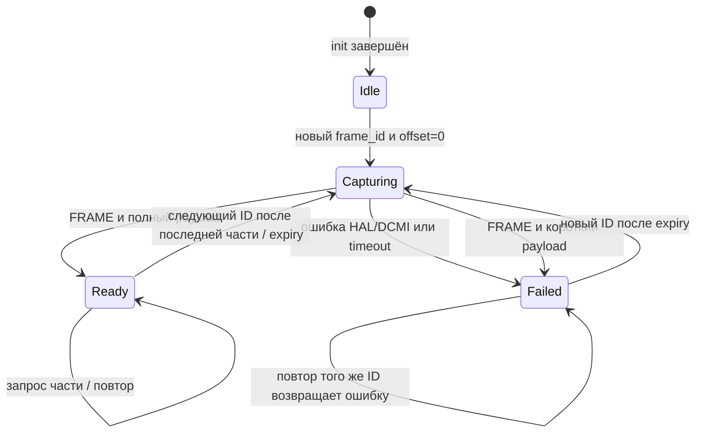

# NUCLEO-H755ZI-Q + OV2640: устройство проекта и алгоритм передачи изображения

Документ относится к рабочей камерной реализации в ветке **main**.
Он связывает плату, GPIO, FreeRTOS, SCCB, DCMI, DMA, Ethernet, UART и Python-клиент.
Главная цель — объяснить, почему код устроен именно так и где искать нужную часть.

## 1. Какие документы читать

| Задача | Документ |
|---|---|
| Подключить каждый провод камеры к контакту Nucleo | [CAMERA_OV2640.md](CAMERA_OV2640.md) |
| Разобраться в GPIO, AF, MCO, I2C2 и UART-командах | [CAMERA_STM32_SETUP_UART.md](CAMERA_STM32_SETUP_UART.md) |
| Посмотреть результаты проверки DMA, исправление VSYNC и хвоста кадра | [CAMERA_DMA_REVIEW.md](CAMERA_DMA_REVIEW.md) |
| Понять весь путь изображения и распределение ответственности | Этот документ |

Аппаратные исходники: UM2408 Rev 6 для MB1363 и OV2640 v1.6 из ваших PDF.
Таблицы GPIO и детали питания модуля приведены в инструкции подключения.
Внешние документы не заменяют проверки фактической маркировки платы/модуля.

## 2. Что представляет собой эта плата

В проекте используется **NUCLEO-H755ZI-Q**, плата **MB1363** с STM32H755ZIT6.
У STM32H755 два ядра: Cortex-M7 и Cortex-M4. Этот Makefile собирает приложение
**CM7**: `CORE_CM7`, Cortex-M7, аппаратная FPU. Камера и lwIP обслуживаются CM7;
второе ядро не используется этим модулем для обработки изображения.
Если отдельно запускать CM4, нельзя давать ему одновременно менять GPIO,
DCMI, DMA2_Stream0 или память этого приложения.

Важные для проекта части Nucleo:

- ST-LINK: прошивка/отладка SWD и Virtual COM Port консоли.
- USART3: PD8 TX, PD9 RX, 115200 8N1, без flow control.
- Ethernet PHY и RJ45: подключены к MAC STM32 по RMII; проект использует lwIP.
- CN7–CN10: штатные Zio-разъёмы, через них подключается камера.
- CN11/CN12: дополнительные площадки ST morpho; их распиновка отдельная.
- Кнопка PC13 и светодиоды: инициализируются существующим кодом main.

HSI выбран источником системных часов: SYSCLK/HCLK/APB в текущем коде 64 МГц,
PLL не используется. Это рабочая настройка проекта, а не максимальная
производительность STM32H755. Частоту нельзя менять только одной строкой:
нужно проверить flash latency, питание, делители, I2C timing и периферийные часы.

Плата и камера имеют общую землю. На присланном модуле вход подписан 3.3V;
его питание берётся с 3V3, не с 5V. Голый сенсор OV2640 имеет несколько питаний,
но на готовом модуле их организация определяется схемой модуля.

## 3. Путь изображения



CM7 не копирует каждый пиксель во время захвата. DCMI принимает параллельные
байты, аппаратный DMA переносит собранные слова в SRAM. CPU вмешивается
при настройке, начале/завершении кадра и отправке частей по сети.

## 4. Какие выводы участвуют

| Группа | Выводы STM32 | Что происходит |
|---|---|---|
| Тактирование камеры | PA8, AF0 MCO1 | HSI 64 МГц / 4 = 16 МГц на XCLK |
| Сброс и сон | PD4, PD5, GPIO outputs | PD4=0 сброс, PD5=1 сон; в работе 1/0 |
| SCCB управления | PB10/PB11, AF4 I2C2 | Запись/чтение регистров сенсора; внешние подтяжки |
| Синхронизация DVP | PA6 PCLK, PA4 HREF, PB7 VSYNC, AF13 | Камера обозначает байты, строки и кадры |
| Младшие биты принятого байта | PC6/PC7/PC8/PC9, AF13 | D2/D3/D4/D5 камеры -> DCMI_D0/D1/D2/D3 |
| Старшие биты принятого байта | PE4/PD3/PE5/PE6, AF13 | D6/D7/D8/D9 камеры -> DCMI_D4/D5/D6/D7 |

Выбор AF подключает GPIO к аппаратной периферии. Например, PA8 не нужно
переключать программно 16 миллионов раз в секунду: после выбора MCO1
сигнал генерируется аппаратно. `GPIO_SPEED_FREQ_VERY_HIGH` задаёт скорость
фронтов драйвера GPIO, а не частоту камеры.

Конфигурация DCMI для **проверенного модуля**:
`PCKPOLARITY_RISING`, `HSPOLARITY_LOW`, **`VSPOLARITY_LOW`**.
VSYNC LOW выбран по реальному захвату. COM10 в sensor bank не следует считать
универсальным описанием полярности выхода DSP во всех форматах/режимах OV2640.

## 5. Организация кода

| Файл | Ответственность |
|---|---|
| [main.c](../Core/Src/main.c) | Периферия базы, настройки, запуск FreeRTOS, две задачи |
| [stm32h7xx_hal_msp.c](../Core/Src/stm32h7xx_hal_msp.c) | GPIO/часы UART, Ethernet, I2C1 |
| [camera_stream.c](../Core/Src/camera_stream.c) | Всё управление камерой, захват, UDP-сервер и диагностика |
| [camera_stream.h](../Core/Inc/camera_stream.h) | Публичный API и структура CameraDiagnostics |
| [app_cli.c](../Core/Src/app_cli.c) | Разбор UART-команд и печать отчётов |
| [ov2640_settings.h](../Core/Inc/ov2640_settings.h) | Таблицы настройки сенсора/DSP |
| [ov2640_regs.h](../Core/Inc/ov2640_regs.h) | Имена банков, регистров и битов OV2640 |
| [STM32H755ZITX_FLASH.ld](../STM32H755ZITX_FLASH.ld) | Размещение flash/RAM и областей настроек |
| `camera_client/client.py` относительно корня проекта | Приём, сборка, преобразование и отображение на ПК |

HAL, CMSIS, lwIP и FreeRTOS в Drivers/Core — библиотечный код; оформление
прикладных функций не меняет их исходники или таблицы настроек камеры.

## 6. Последовательность включения

1. `main()` устанавливает VTOR на векторы приложения, запускает HAL и часы.
2. Инициализируются GPIO базы, TIM2, RTC, USART3, I2C1.
3. Читаются настройки устройства; создаётся очередь UART RX.
4. Запускаются задачи `lwipProc` и `uartProc`, затем scheduler.
5. `lwipProc` настраивает Ethernet, lwIP и существующий TFTP.
6. `camera_stream_init()` подготавливает аппаратные ресурсы камеры.
7. PA8 начинает выдавать XCLK, PD5=0, PD4 сначала 0, затем 1.
8. Инициализируются I2C2, DMA2_Stream0, DCMI и IRQ.
9. По SCCB читается PID, ожидается 0x2642.
10. Выполняются программный сброс и последовательности настройки DSP.
11. Настраивается RGB565 320×240, выдерживается пауза после настройки.
12. Создаётся UDP PCB и привязывается порт 5000.
13. Публикуется готовность диагностики; CLI выводит стартовый отчёт.
14. Приложение ждёт запросов кадра; постоянного захвата до запроса нет.

Если камера не отвечает, UDP-сервер всё равно запускается и возвращает статус
ошибки. `camera_init_error` показывает этап отказа. Только невозможность
создать/привязать сам сервер приводит к фатальному Error_Handler.

## 7. SCCB: как STM32 настраивает OV2640

`camera_write_register(reg, value)` отправляет два байта на I2C2.
7-битный адрес OV2640 — 0x30, в STM32 HAL он передаётся как 0x60.

`camera_read_register(reg, &value)` сначала отправляет адрес регистра,
затем читает байт отдельной транзакцией; между фазами есть STOP.

Регистр BANK_SEL=0xFF выбирает пространство регистров:
1 — sensor, 0 — DSP. Номер регистра без банка недостаточен для диагностики:
одинаковый адрес в разных банках означает разные параметры.

`camera_write_register_table()` проходит пары {регистр, значение} по порядку.
Пара {0,0} заканчивает таблицу. На первом отказе запись прекращается,
запоминаются банк/регистр/статус. Переставлять строки таблиц нельзя: некоторые
значения зависят от ранее выбранного банка и внутреннего состояния DSP.

В таблице окна ZMOW=80 и ZMOH=60 означают 320 и 240 пикселей, потому что
эти значения задаются в единицах четырёх пикселей. RGB565 задаёт два байта
на пиксель; CPU не выполняет сжатие JPEG.

## 8. Две задачи и прерывания

| Контекст | Что можно делать | Что он не делает |
|---|---|---|
| `lwipProc` | Raw lwIP, UDP callback, управление захватом, чтение HAL, публикация диагностики | Не печатает UART |
| `uartProc` | Очередь RX, CLI, чтение снимка CameraDiagnostics, UART TX | Не вызывает raw UDP API и не перенастраивает камеру |
| IRQ DCMI | HAL обработчик, выставление completed/failed | Не копирует кадр, не отправляет UDP, не ждёт |
| IRQ DMA2_Stream0 | HAL обработчик DMA | Не вызывает CLI |
| IRQ USART3 | Приём одного байта, очередь FromISR, перевзвод RX | Не выполняет команды пользователя |

FreeRTOS есть, но lwIP настроен **NO_SYS=1**. Поэтому наличие scheduler
не означает потокобезопасность сетевого стека: все raw API остаются у одного
владельца. В цикл lwipProc входят `MX_LWIP_Process()`, `camera_stream_poll()`
и короткая задержка. MX_LWIP_Process также обслуживает таймеры lwIP.

IRQ камеры имеют приоритет 6. Их callbacks короткие: только помечают событие.
Основная работа выполняется в задаче, где можно обращаться к HAL и сетевым
буферам без смешивания контекстов.

## 9. Размеры и размещение памяти

```text
Изображение:          320 × 240 × 2 = 153600 байт = 38400 слова
Защитный хвост:                      128 байт =    32 слова
Общий буфер DMA:                  153728 байт = 38432 слова
```

`frame[]` — статический массив `.bss` в **RAM_D1 / AXI SRAM** с началом
области 0x24000000. Массив выровнен на 32 байта. Это не DTCM, доступное CPU
другим путём. Проверка на плате подтвердила, что DMA2 пишет в этот буфер.

Длина HAL_DCMI_Start_DMA указывается **в 32-битных словах**, не в пикселях
и не в байтах. 38432 укладывается в счётчик одного stream, поэтому двойной
буфер и специальное разбиение длинных DMA-транзакций не нужны.

Настройки stream: направление peripheral-to-memory, неизменный адрес
DCMI_DR, возрастающий адрес памяти, word/word, normal mode, FIFO enabled.
DMAMUX сопоставляет запрос DCMI с DMA2_Stream0.

Зачем запас: реальный опыт показал хвостовые DVP байты после полезного
изображения. Без запаса DMA заканчивается раньше аппаратного конца кадра,
DCMI получает OVR. Защитный хвост принимается в SRAM, но не передаётся ПК.

FRAME IRQ включается при старте, не после полного заполнения хвоста.
По концу кадра вычисляется:

```text
received_words = DMA_WORDS - remaining
кадр полный, если received_words >= FRAME_BYTES / 4
```

При frame-ok остаток DMA 0…32 допустим. Он означает незаполненный хвост,
а не потерянные пиксели. Если FRAME пришёл до полного payload, результат —
short-frame и клиент не получает неполное изображение.

## 10. D-cache: зачем clean/invalidate

DMA пишет SRAM вне обычного механизма загрузки cache lines CPU. При включённом
D-cache CPU может увидеть старую копию строки вместо данных DMA.
Поэтому код перед захватом делает clean/invalidate диапазона **всего буфера**,
а после завершения invalidate. Выравнивание адреса и размера 32 байта
не позволяет случайно задеть соседние данные при обслуживании cache lines.

Операции выполняются только при установленном SCB_CCR_DC_Msk. На плате
во время проверки D-cache был выключен; механизм оставлен на случай его
дальнейшего включения. Включение cache потребует проверки также существующего
Ethernet-драйвера и его буферов — одной камеры недостаточно.

## 11. Состояния захвата



В коде состояния представлены флагами `capturing`, `valid`, `completed`,
`failed`, а не отдельным enum. `completed`/`failed` могут выставляться IRQ;
остальные решения принимает lwipProc.

Для каждого нового кадра:

1. Останавливается предыдущий DMA/DCMI.
2. Отключается FRAME IRQ на время очистки оставшихся флагов.
3. Снова включаются FRAME/LINE/VSYNC/ERR/OVR interrupts.
4. Сбрасывается DCMI ErrorCode и флаги текущей попытки.
5. Запоминаются владелец, ID, время начала.
6. При необходимости обслуживается D-cache.
7. Запускается HAL_DCMI_Start_DMA в snapshot.
8. Клиент получает busy и продолжает повторять запрос.

Восстановление interrupts необходимо: HAL отключает их после snapshot.
Очистка флагов не позволяет принять конец прошлого кадра за конец нового.

## 12. Как завершается кадр

`camera_stream_poll()` вызывается при каждом проходе сетевой задачи.
Раз в 25 мс он обновляет опубликованную диагностику.

Если capture не идёт, больше ничего делать не нужно.
При failed либо возрасте больше 3000 мс сохраняется pre-stop состояние,
выполняется HAL_DCMI_Stop и увеличивается счётчик ошибок.

При completed считывается остаток DMA, проверяется полезный объём,
сохраняется pre-stop состояние, останавливается DMA/DCMI и обслуживается
D-cache. Только после этого `valid=1` делает изображение доступным UDP.

Ошибки и timeout проверяются раньше completed. Это защищает от выдачи
кадра, для которого одновременно появились признаки завершения и отказа.

## 13. Протокол CAM1: запрос

Все многобайтовые числа заголовка big endian. Запрос всегда 12 байт:

| Смещение | Размер | Значение |
|---|---|---|
| 0 | 4 | ASCII CAM1 |
| 4 | 4 | frame_id, случайный u32 клиента |
| 8 | 4 | offset, смещение полезных байтов в изображении |

Первый запрос нового ID должен иметь offset=0. Он запускает snapshot.
Повтор того же ID от того же отправителя не запускает DMA повторно.
Пока камера занята, ответ имеет status=1 и не содержит пикселей.
После готовности offset=0 возвращает первые 1200 байт изображения.

Далее клиент запрашивает offsets 1200, 2400, …, 152400.
Всего **128 частей по 1200 байт**. Контроль `off < FRAME_BYTES`
и `off % CHUNK == 0` не позволяет выйти за пределы полезного буфера.

Запросы другой длины или с другим magic отбрасываются без ответа.
Входной pbuf освобождается даже в этих ветках; lwIP может выдать цепочку
pbuf, поэтому заголовок читается через pbuf_copy_partial.

## 14. Протокол CAM1: ответ

Заголовок всегда 24 байта:

| Смещение | Размер | Поле |
|---|---|---|
| 0 | 4 | ASCII CAM1 |
| 4 | 4 | frame_id запроса |
| 8 | 4 | offset запроса |
| 12 | 4 | total=153600 |
| 16 | 2 | width=320 |
| 18 | 2 | height=240 |
| 20 | 4 | status |
| 24 | 0 или 1200 | Полезные RGB565 байты |

| status | Значение |
|---|---|
| 0 | Успешная часть изображения |
| 1 | Ожидание захвата или буфер занят другим кадром/клиентом |
| 2 | Ошибка инициализации либо захвата |
| 3 | Некорректное смещение |

Статусы 1/2/3 возвращают только заголовок. Максимальная UDP-нагрузка —
1224 байта, что помещается в обычный Ethernet MTU без IP-фрагментации.
`read_be32()`/`write_be32()` работают по байтам и не требуют выравнивания
входного сетевого указателя на 4 байта.

## 15. Один буфер, владелец и повторные запросы

Владелец определяется тройкой: IP отправителя, UDP-порт, frame_id.
Пока он читает кадр, следующий клиент не может перезаписать буфер.
Обычные запросы владельца обновляют touched; срок удержания — 10 секунд.

После выдачи последней части touched сдвигается так, чтобы новый ID мог
сразу начать следующий кадр. Старый кадр сохраняется и последнюю часть
можно повторно запросить, пока новый захват ещё не начат.
Это разрешение на новый кадр, а не подтверждение доставки последнего пакета.

После ошибки тот же ID продолжает получать ошибку. Новый ID может быть
временно занят до окончания срока владельца. Это текущее ограничение
простого протокола: сервер не имеет отдельных команд release/cancel.

Потеря UDP-пакета обрабатывается повтором запроса части. Здесь нет полного
TCP transport, скользящего окна, аутентификации или отдельного прикладного CRC.
Проверка целостности Ethernet/UDP зависит от существующей настройки MAC/lwIP.
Протокол рассчитан на локальную сеть и одного активного потребителя.

## 16. Алгоритм Python-клиента

`receive_frame()` создаёт случайный frame_id и общий deadline 8 секунд.
Socket имеет короткий timeout 0.2 секунды; timeout отдельного пакета
не означает окончательный отказ, запрос повторяется.

Для каждой части клиент:

1. Отправляет CAM1 с текущими ID/offset.
2. При timeout повторяет тот же запрос.
3. Проверяет минимальную длину ответа.
4. Проверяет magic, ID и offset; чужие/задержанные ответы игнорирует.
5. Проверяет total, width, height.
6. При busy ждёт 20 мс и повторяет запрос.
7. При статусе ошибки завершает текущую попытку исключением.
8. Проверяет точную длину части, добавляет payload и увеличивает offset.
9. Возвращает только полный кадр.

`rgb565_to_rgb()` соединяет два байта в 16-битный пиксель:

```text
RRRRR GGGGGG BBBBB
5 бит красного, 6 бит зелёного, 5 бит синего
```

Каждый компонент расширяется до 8 бит. `--swap-bytes` меняет порядок байтов
пикселя; геометрия кадра и порядок частей не меняются.

С `--save` файл PPM пишется без Pillow/tkinter. В GUI сетевой worker работает
в отдельном потоке, главный поток tkinter обновляет виджет через очередь.
Это позволяет двигать/закрывать окно, пока захват ждёт timeout.
При ошибке worker выводит её через очередь и пробует снова.

`--test-pattern` нужен прошивке ветки testpattern. main принимает только CAM1;
запрос TST1 к main не вернёт тестовую картинку.

## 17. UART: наблюдение без вмешательства в захват

`publish_diagnostics()` читает HAL и регистры в lwipProc, затем под короткой
critical section копирует структуру в published. `camera_get_diagnostics()`
копирует published в структуру CLI. Ни getter, ни CLI не перенастраивают HAL.

`capture_result()` сохраняет остаток DMA, CR/SR/RIS и коды ошибок **до stop**.
Остановка меняет регистры; без сохранения можно потерять причину отказа.

Команда `camera` показывает один снимок, `camera watch on` — отчёты примерно
раз в секунду, `camera watch off` выключает периодическую печать.
Если пользователь вводит строку, watch ждёт её завершения.
После init камера также выдаёт однократный стартовый отчёт.

Уровни GPIO в отчёте — отдельные выборки. Для измерения частоты/ширины
импульсов нужны осциллограф или логический анализатор.
`replies` означает успешную передачу пакета в lwIP, не подтверждение ПК.

## 18. Карта функций camera_stream.c

| Функция | Назначение |
|---|---|
| `camera_hardware_init` | GPIO, часы, SCCB, DMA, DCMI и IRQ |
| `configure_gpio_pins` | Общая настройка режима/AF группы GPIO |
| `camera_write_register`, `camera_read_register` | SCCB операции с одним регистром |
| `camera_write_register_table` | Таблица инициализации по порядку |
| `sccb_result` | Фиксация места отказа SCCB |
| `camera_stream_init` | PID, таблицы, UDP bind и публикация готовности |
| `camera_udp_receive` | Запуск кадра, владение буфером, ответ частью изображения |
| `read_be32`, `write_be32` | Сериализация сетевых чисел |
| `camera_stream_poll` | Конец/ошибка/timeout и диагностика |
| `capture_result` | Pre-stop регистры последнего результата |
| `publish_diagnostics`, `camera_get_diagnostics` | Снимок для UART |
| IRQ handlers | Делегирование в HAL |
| HAL callbacks FRAME/Error | Только выставление флагов |

В каждой функции добавлена шапка с назначением, параметрами и контекстом,
где это важно. Пустые строки разделяют инструкции. Таблицы/массивы данных
не являются последовательностью исполняемых инструкций и оформляются компактнее.

## 19. Память flash и сборка

Активный linker script размещает приложение с **0x08020000**, сохраняя
начальную область для существующего загрузчика. Область приложения FLASH1 —
384 КиБ. Сохранённые настройки выделены отдельно в секторах SETTINGS_A/B.
Не записывайте BIN без указания правильного адреса и не стирайте всю flash,
если нужно сохранить загрузчик/настройки.

```bash
cd ~/projstm/stm_sandbox
git branch --show-current
make -j4
python3 tests/run_host_tests.py
```

ELF/BIN/HEX находятся в build. ELF содержит адреса размещения; BIN сам по себе
адресов не содержит. Параметры `.RAM` linker script не применяются, пока
Makefile выбирает FLASH script.

Тесты settings/CLI проверяют host-логику; они не заменяют DCMI/DMA на плате.
После изменения формата, clocks или GPIO нужен реальный захват и просмотр UART.

## 20. Что подтверждено и что ещё ограничено

На Nucleo проверены: SCCB PID=0x2642, доступ DMA2 к AXI SRAM, захват пяти
последовательных настоящих кадров, передача 153600 байт через UDP и UART
`frames=5 errors=0`. Исправлены полярность VSYNC, запас буфера и восстановление IRQ.

На части изображений остаются цветные помехи. Их источник не установлен;
нельзя объявлять качество картинки исправленным только по нулевым HAL ошибкам.
Короткие провода, общая земля, питание и фронты PCLK/DVP нужно оценивать
отдельно. Размер защитного хвоста также ограничен: если при другом режиме
камера выдаст больше запаса, потребуется пересмотр буфера/формата.

Оформление кода и комментарии не меняют алгоритм: проверка BIN до/после
оформления показала побайтное совпадение прошивки. Python-клиент проверяется
на сохранение исполняемого AST, за исключением поясняющих docstrings.
